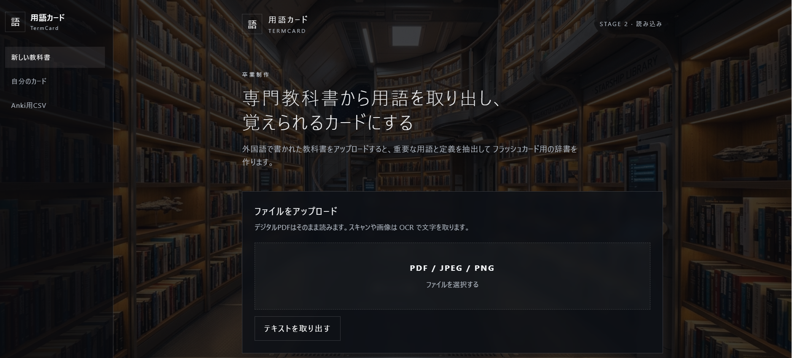

# TermCard（用語カード）

**Upload scans of a textbook — get flashcards of its key terms, ready for Anki.**
教科書のスキャンをアップロードするだけで、重要用語の単語カードを自動作成し、Ankiに取り込めるアプリです。



---

## Why I built it / 制作のきっかけ

When I started college in Japan, we got a huge stack of textbooks full of technical terms. I tried typing them into Anki by hand and gave up in chapter 3 of the very first book. So I wanted an app that reads the textbook scans, finds the topic and the key terms for me, and makes the cards automatically. This year, after building small apps in class, I felt ready to build something bigger. It's not perfect yet, but it already handles my own textbooks.

専門学校に入学したとき、専門用語だらけの教科書が大量に配られました。Ankiに手入力しようとしましたが、1冊目の第3章で挫折。そこで「教科書のスキャンを入れるだけで、テーマと重要用語を抽出し、カードを自動で作ってくれるアプリ」があればと思い、授業で小さなアプリを作った経験を活かして開発しました。まだ改善の余地はありますが、自分の教科書ではすでに実用できています。

## Features / 主な機能

- Upload PDF or image scans (OCR with Tesseract for Japanese and English) / PDF・画像のアップロード（Tesseract OCR）
- Detects the language and topic of a chapter / 言語とテーマの自動判定
- Extracts key terms with definitions (glossary and in-text definitions, Wikipedia, optional Gemini API) / 重要用語と定義の抽出
- Translates cards into other languages (Japanese, English, Russian, Ukrainian, Chinese, …) / カードの多言語翻訳
- Adds readings (furigana) for Japanese terms / 日本語用語の読み仮名
- Library of documents and decks, card selection / ドキュメント・デッキの管理
- Export to Anki as CSV / Anki用CSVエクスポート

## Tech stack / 使用技術

Python, Flask, Flask-SQLAlchemy (SQLite by default, MySQL supported), Jinja2 templates, HTML/CSS, PyMuPDF, Pillow, pytesseract, pykakasi, deep-translator, Gemini API (optional)

## How to run / 起動方法

```bash
cd app
python -m venv .venv
.venv\Scripts\activate        # Windows (macOS/Linux: source .venv/bin/activate)
pip install -r requirements.txt
python app.py
```

Tesseract OCR must be installed (with Japanese language data).
Optional: create `app/.env` with `GEMINI_API_KEY=...` for better term extraction and translation.
The `.env` file is not included in this repository.

## Author / 作者

Anna Zorych — [LinkedIn](https://www.linkedin.com/in/anna-zorych/)
